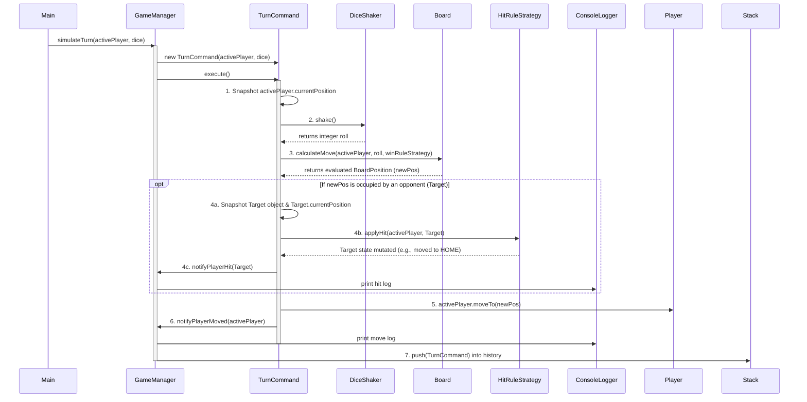
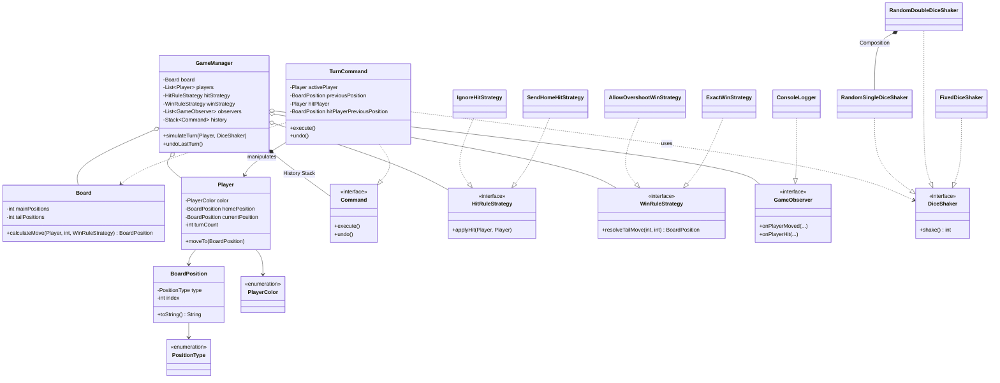

# Simple Frustration Document

## Section 1: Key Classes, Architecture and Design Advantages

In order to have a high-cohesion and low-coupling architecture, the 20 components of the system have been divided into six functional modules. Every class, interface, and enum has been designed according to the **SOLID principles** and avoids primitive obsession.

### 1.1 Foundation & Data Entities

*   **`PlayerColor` & `PositionType` (Enums)**
    *   **Responsibility:** Define the set of valid colors (`RED`, `BLUE`, `GREEN`, `YELLOW`) and board areas (`HOME`, `MAIN`, `TAIL`, `END`).
    *   **Design Benefit:** Offers strong **Type Safety**. Replaces arbitrary string or integer identifiers with Enums to prevent runtime errors due to typos and invalid states.

*   **`BoardPosition` (Value Object)**
    *   **Responsibility:** A particular location on the board with a `PositionType` and an index. It also has a string-formatting function for logs.
    *   **Design Benefit:** Addresses **Primitive Obsession**. To make the class immutable, declare its fields as `final` and do not provide setters; otherwise, the data of a position will be changed accidentally during complex game operations or state saving. Overriding `toString()` complies with the **Single Responsibility Principle (SRP)** and keeps UI formatting out of the game engine.

*   **`Player` (Entity)**
    *   **Responsibility:** Stores the attributes of a game player, such as color, home base, current location, and turn number.
    *   **Design Benefit:** Achieves **Encapsulation**. Internal states are `private` and can only be changed by explicit command methods (`moveTo`, `incrementTurn`). Thus, the external class will not set an invalid turn count or illegal coordinates.

### 1.2 Core Game Engine & Mathematics

*   **`Board` (Mathematical Model)**
    *   **Responsibility:** Calculate the exact destination of a player based on their current position, a dice roll, and the dimensions of the board (main size and tail size).
    *   **Design Benefit:** Isolate the mathematical logic from the game controller to adhere to **SRP**. The Large Board variation can be used directly by providing only different parameters (e.g., 36 and 6) to the constructor without code modification.

*   **`GameManager` (Core Controller)**
    *   **Responsibility:** Manages the game lifecycle. It saves references to the board, players, injected strategies, and command history, and distributes turns without performing the low-level arithmetic.
    *   **Design Benefit:** Serves as a high-level coordinator that uses **Dependency Injection (DI)**. Delegate the rules to strategies, print to observers, and use the board for math to achieve very loose coupling.

### 1.3 Power Source

*   **`DiceShaker` (Interface)**
    *   **Responsibility:** Defines the contract for generating movement steps (`shake()`).
    *   **Design Benefit:** Implements the **Dependency Inversion Principle (DIP)**. `GameManager` uses this interface and does not need to know about concrete dice for logic switching.

*   **`RandomSingleDiceShaker` & `RandomDoubleDiceShaker` (Implementations)**
    *   **Responsibility:** Generate random values (1-6 or 2-12).
    *   **Design Benefit:** The Double Dice shaker uses the **Composite Reuse Principle** to create two Single Dice instances instead of inheritance and reduces coupling.

*   **`FixedDiceShaker` (Implementation)**
    *   **Responsibility:** Return numbers sequentially from a pre-defined array.
    *   **Design Benefit:** Necessary for Automated Testing & Demonstration. Deterministic testing of the complex edge case (Exact Win backoff) can be carried out without randomness.

### 1.4 Rule Engines

*   **`HitRuleStrategy` (Interface), `IgnoreHitStrategy`, & `SendHomeHitStrategy`**
    *   **Responsibility:** Determine the behavior of a player upon landing on an occupied square. `IgnoreHitStrategy` does nothing (Basic Game), and `SendHomeHitStrategy` teleports the victim to HOME (Variation).
    *   **Design Benefit:** Follows the **Open-Closed Principle (OCP)**. Do not use a fragile `if-else` statement in the `GameManager` for collision logic. New rules can be added as new classes without changing the existing code.

*   **`WinRuleStrategy` (Interface), `AllowOvershootWinStrategy`, & `ExactWinStrategy`**
    *   **Responsibility:** Calculate the final placement upon entering the TAIL. `AllowOvershoot` permits going past END, and `ExactWin` activates a complex backoff calculation.
    *   **Design Benefit:** Similar to Hit Rules, extract the winning algorithms as swappable strategies to keep the core engine unchanged by modifications to the variation.

### 1.5 Undo Management

*   **`Command` (Interface) & `TurnCommand` (Implementation)**
    *   **Responsibility:** Encapsulate a single player's turn (rolling, moving, hitting) into a standalone object with `execute()` and `undo()` methods.
    *   **Design Benefit:** Solves the complex Undo a Hit requirement. The command records the crime scene, which is the moving player's previous state and the exact position of the victim at the time of impact. It can restore the previous state perfectly (resurrecting the player at the correct position) without using rollback logic in `GameManager`.

### 1.6 Console logs

*   **`GameObserver` (Interface) & `ConsoleLogger` (Implementation)**
    *   **Responsibility:** Listen to game events (move, hit, overshoot, undo) and format them for console output.
    *   **Design Benefit:** Decouples business logic from UI presentation. The `GameManager` (Observable) only emits events. `ConsoleLogger` is the only class allowed to use `System.out.println()`; otherwise, the system will not be suitable for future upgrades.

---

## Section 2: Core Algorithms and Feature Implementations

This section presents the mathematical and logical algorithms employed in the implementation of the main game physics, variations, and advanced functions.

### 2.1 Circular Board & Tail Routing Algorithm (`Board.calculateMove`)
*   **Feature Implemented:** Basic game movement and the Large Board variation.
*   **How it works:** Instead of using a fixed-position index (e.g., `if position > 18`), a mathematical Diversion Point is calculated for each player, which is exactly one index before their `HOME` index.
    1. Calculate the distance from the player's current location to the diversion point accurately.
    2. If the `roll <= distance`, the player stays on the main board. The algorithm is a modulo-like wrap-around mechanism (`nextIndex -= mainPositions`) for circular movement.
    3. If the dice roll is too large, then it will be a tail. Determine the remaining steps (`stepsIntoTail`) by the algorithm and call the injected `WinRuleStrategy` with the final position.
*   **Why employ this algorithm:** To prevent hardcoded limits. The board can be seen as a problem in mathematical geometry to handle different sizes of the board (e.g., 36 main + 6 tails) automatically without modifying any logic; only the constructor arguments need to be changed.

### 2.2 Exact Win & Overshoot Backoff Algorithm (`ExactWinStrategy`)
*   **Feature Implemented:** The Exact END Position Win variation.
*   **How it works:** When the player reaches the end, determine if `stepsIntoTail` is equal to `tailPositions`. If it is longer than the tail length, then a two-phase backoff calculation will be performed:
    1. Therefore, it has not yet come to an end, calculate the overshoot amount.
    2. It calculates the `backoffPos = tailPositions - overshoot`.
    3. If `backoffPos > 0`, the player bounced back but stayed in the TAIL.
    4. If `backoffPos <= 0`, the player has moved out of the TAIL. Subtract this negative value from the diversion point and place them on the main board in reverse order, and connect circularly if necessary.
*   **Why employ this algorithm:** The boundary physics of bouncing back in the two coordinate systems (Tail and Main) are very complex. Encapsulate this algorithm in a Strategy to keep the `Board` class clean and comply with the **Single Responsibility Principle (SRP)**.

### 2.3 State-Capturing Undo Algorithm (`TurnCommand`)
*   **Feature Implemented:** The Undo a Hit advanced feature.
*   **How it works:** It works by performing a reverse addition of the old state. Reversing a collision (Hit) needs to restore a damaged state.
    1. **Execute (Capture):** Before moving the active player, the `TurnCommand` captures their `previousPosition`. It will automatically find the destination. If an opponent is at the destination square, the command will save a reference to this `hitPlayer` and cache their `hitPlayerPreviousPosition` before executing the collision strategy.
    2. **Undo (Restore):** The command moves the current player back to the previous location. Then it checks the cache. If a victim was recorded, it explicitly calls `hitPlayer.moveTo(hitPlayerPreviousPosition)` to teleport the victim back to the scene of the crime.
*   **Why employ this algorithm:** This implementation of the Command Pattern offers $O(1)$ state restoration. Instead of saving the entire world state of all players at each turn, only the delta (that is to say, the objects and positions that have changed in that particular turn) is saved by the command to achieve high performance.

---

## Section 3: Logical Sequence of Execution

This section will introduce the logical life cycle of a single player's turn in detail. It shows the exact sequence of data flow, state management, and component interaction for dice rolling, collision resolution, and history archiving.

### 3.1 Execution Flow (Sequence Diagram)

### 3.2 Comprehensive Lifecycle of a Turn

To guarantee data consistency and support advanced functions such as Undo, a strict 7-stage life cycle for the execution of a turn is employed.

1. **Turn Encapsulation (Command Initialization):** When `GameManager.simulateTurn()` is called, the engine does not immediately change player positions. Instead, it creates a `TurnCommand` and injects the active player and the power source (`DiceShaker`). Therefore, the responsibility of turn execution will be borne by the Command pattern.
2. **State Snapshot & Power Generation:** Before any mutation takes place, the `TurnCommand` creates a deep copy of the active player's `currentPosition`. Then it calls the `shake()` method of the abstract `DiceShaker` to obtain a movement value, and the main logic is completely independent of whether 1 or 2 dice are used.
3. **Mathematical Evaluation (Board routing):** The command passes the active player and the dice roll to the pure mathematical engine: `Board.calculateMove()`. The `Board` determines the distance from the tail to the diversion point. If the roll exceeds this limit, then the `Board` will need to ask the dynamically added `WinRuleStrategy` for the final placement calculation of the win or overshoot. A final, immutable `BoardPosition` is returned.
4. **Proactive Collision Resolution:** Before moving the active player, the `TurnCommand` scans the evaluated destination square. If there is an opponent, then the command will obtain the victim's object reference and its original position immediately. Only after this snapshot is saved will the injected `HitRuleStrategy` be invoked to perform the variation logic like sending the victim HOME.
5. **Execution (Mutation):** After resolving all collisions and safely caching the previous state, the command finally mutates the active player's state by calling `activePlayer.moveTo(newPos)` and updating their turn count.
6. **Event Broadcasting (Observer Trigger):** `TurnCommand` calls the notification methods of the `GameManager` (Observable). `GameManager` blindly broadcasts the state change to `ConsoleLogger` (an Observer), and `ConsoleLogger` formats and prints the exact specifications required by the assignment brief without changing the domain logic.
7. **History Archiving:** The fully executed `TurnCommand`, which now contains the complete scene of the crime (previous positions of both the active player and any victims), is pushed onto the `GameManager`'s history Stack. If `undoLastTurn()` is called subsequently, this command is popped, and its exact snapshot data is used to perfectly reverse the timeline in $O(1)$ time.

---

## Section 4: Advanced Design Patterns & UML Class Diagram

Finally, the entire structure of the system is shown in a complete UML Class Diagram, and an analysis of how the Gang of Four Design Patterns have met the SOLID principles is provided.

### 4.1 Complete System Architecture (UML Class Diagram)

### 4.2 Macro-Level Design Pattern Discussion

This project strictly applies OOD patterns and adheres to SOLID principles to support maintainability and extensibility.

1. **Strategy Pattern -> Open-Closed Principle (OCP):** Abstract the collision rules (`HitRuleStrategy`) and the tail-movement rules (`WinRuleStrategy`) into interchangeable interfaces, and the core `GameManager` engine will remain closed to modification but fully open for extension. When a new game variation is needed, a new strategy class can be implemented and injected at runtime without altering the core logic of the existing system.
2. **Observer Pattern -> Single Responsibility Principle (SRP) & Loose Coupling:** The assignment brief needs to provide many different formats for console output of turn events. Directly embedding `System.out.println` in `GameManager` or `TurnCommand` would lead to serious console UI logic coupling. The Observer Pattern will be used to handle I/O string formatting in `ConsoleLogger`. The `GameManager` is only an Observable broadcaster, so it is completely decoupled and suitable for future GUI integration of the engine.
3. **Command Pattern -> Encapsulation & Robust State Management:** Implementing an undo function for complex collisions is inherently difficult because of state destruction. The Command Pattern (`TurnCommand`) can be used to encapsulate a functional operation within a state-holding object. The command locally caches the exact delta of the crime scene (the victim's reference and their precise location before the hit) and can achieve $O(1)$ perfect state restoration without using large global mementos in the `GameManager`.